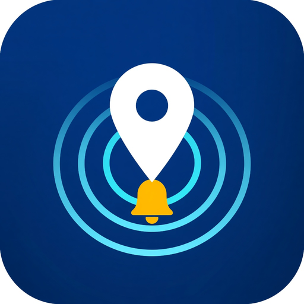

# on-the-go

<div align="center">
  
  <br/>
  <h3>Автономный GPS-будильник и умные оповещения по гео-точкам во время поездок</h3>

  [](https://www.rustore.ru/catalog/app/ru.routealert.app)
  []()
  []()
  [-4285F4?style=for-the-badge&logo=jetpackcompose&logoColor=white)]()
  []()
</div>

---

## 🎯 О проекте

**on-the-go** — это мобильное Android-приложение, созданное для тех, кто часто передвигается на поездах, электричках, междугородних автобусах или метро. Вы отмечаете точку на карте (станцию, остановку, ориентир), запускаете поездку — и можете спокойно спать или слушать музыку: смартфон гарантированно разбудит вас при приближении к заданной локации.

> 🔒 **100% Приватность и оффлайн:** Все координаты, точки и персональные настройки хранятся исключительно в памяти вашего устройства (локальная база Room). Никаких регистраций, сбора личных данных или передачи истории перемещений на сторонние серверы.

---

## ✨ Ключевые возможности

* 📍 **Быстрая разметка точек:** Удерживайте палец на карте или воспользуйтесь поиском адреса / географических координат (`45.03, 38.97`).
* 🔔 **3 типа оповещений:**
  * **Уведомление:** виброотклик и всплывающее live-сообщение в шторке.
  * **Будильник:** громкий звуковой сигнал через медиа-канал с полным обходом ограничений системного сна (WakeLock).
  * **Комбинированный:** уведомление + громкий сигнал.
* ⚡ **Live-трекинг в шторке:** Отображение актуальной дистанции и расчётного приближения прямо в постоянном системном уведомлении через `Foreground Location Service`.
* 🔋 **Бережное энергопотребление:** Адаптивный интервал опроса сенсоров в зависимости от скорости и расстояния до цели для предотвращения быстрой разрядки батареи.
* 🔄 **Обмен точками (Pro):** Мгновенная передача сохранённых гео-зон через QR-код или защищённую ссылку `onthego://import`.
* 📊 **Скрытая телеметрия и статистика:** Встроенная изолированная панель для администратора.

---

## 🛠 Технологический стек

* **Язык разработки:** Kotlin (Coroutines, StateFlow, Flow)
* **Пользовательский интерфейс:** Jetpack Compose + Material 3 + Custom Liquid Glass Design
* **Картография & Геокодинг:** Yandex MapKit SDK + OpenStreetMap Nominatim
* **Геолокация:** Google Play Services Fused Location Provider
* **Фоновые процессы:** Android Foreground Services, Android WorkManager
* **Локальное хранилище:** Room Database (SQLite), Jetpack DataStore Preferences
* **Архитектура:** MVI / Clean Architecture principles

---

## 🚀 Сборка и запуск

### Требования
* Android Studio Ladybug или новее
* JDK 17+
* Android SDK 35
* API-ключ [Yandex MapKit](https://developer.tech.yandex.ru/)

### Быстрый старт:
1. Клонируйте репозиторий:
   ```bash
   git clone https://github.com/Dragov/on-the-go.git
   ```
2. Скопируйте файл конфигурации:
   ```bash
   cp local.properties.example local.properties
   ```
3. Укажите в `local.properties` путь к Android SDK и ваш ключ Yandex MapKit:
   ```properties
   sdk.dir=C:\\Users\\YOUR_USER\\AppData\\Local\\Android\\Sdk
   YANDEX_MAPKIT_API_KEY=your_yandex_mapkit_key_here
   ```
4. Выполните сборку:
   ```bash
   ./gradlew assembleDebug
   ```

---

## 📬 Контакты разработчика

* **Разработчик:** Dragov
* **Telegram:** [@huntsvr](https://t.me/huntsvr)
* **Email:** [dflux@internet.ru](mailto:dflux@internet.ru)
* **Каталог RuStore:** [on-the-go в RuStore](https://www.rustore.ru/catalog/app/ru.routealert.app)
